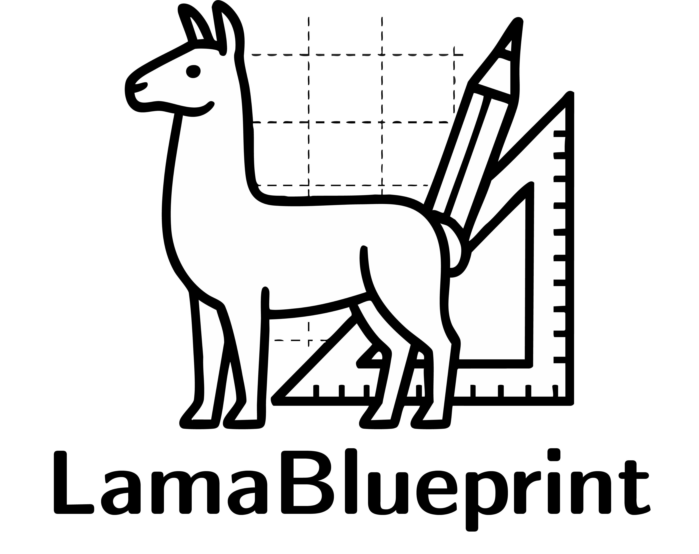

<p align="center">
  
</p>

<p align="center">
  <a href="https://github.com/lamalab-org/LamaBlueprint/actions/workflows/main.yml">
    
  </a>
  <a href="https://github.com/lamalab-org/LamaBlueprint/blob/main/pyproject.toml">
    
  </a>
  <a href="https://img.shields.io/github/license/lamalab-org/LamaBlueprint">
    
  </a>
</p>

---

# LamaBlueprint

> **LamaBlueprint** is LamaLab’s opinionated, batteries‑included Cookiecutter template for starting modern Python projects.
> It began life as a fork of [cookiecutter‑uv](https://github.com/fpgmaas/cookiecutter-uv) and has since been adapted and extended to match LamaLab’s tooling, conventions, and CI/CD workflow.

The template provides everything you need to go from `git init` to a production‑ready Python package – with **zero manual yak‑shaving**.

## Quickstart

```bash
# with uv already installed
a) uvx cookiecutter https://github.com/lamalab-org/LamaBlueprint.git

# or the traditional way
b) pip install --user cookiecutter
   cookiecutter https://github.com/lamalab-org/LamaBlueprint.git
```

Answer a handful of prompts and the template will scaffold your new project.
Then `cd` into the freshly‑created directory and follow the generated `` to finish the setup (creating the lock‑file, activating the pre‑commit hooks, etc.).

## What you get out‑of‑the‑box

* **Dependency management** with [**uv**](https://docs.astral.sh/uv/)
* Choice between [**src**](https://packaging.python.org/en/latest/discussions/src-layout-vs-flat-layout/)[ and ](https://packaging.python.org/en/latest/discussions/src-layout-vs-flat-layout/)[**flat**](https://packaging.python.org/en/latest/discussions/src-layout-vs-flat-layout/)[ project layouts](https://packaging.python.org/en/latest/discussions/src-layout-vs-flat-layout/) 🗂️
* **CI/CD** pipelines via **GitHub Actions** (lint, type‑check, tests, release) ⚙️
* **Pre‑commit** hooks powered by [pre‑commit](https://pre-commit.com/) 🪄
* **Code quality**: [ruff](https://github.com/astral-sh/ruff) (linter/formatter) • [mypy](https://mypy.readthedocs.io/) (static types) • [deptry](https://github.com/fpgmaas/deptry/) (unused/implicit deps)
* **Testing & coverage** with [pytest](https://docs.pytest.org/en/stable/) ✅
* **Docs** generation with [MkDocs Material](https://www.mkdocs.org/) 📚
* **Multi‑Python** compatibility tests via [tox‑uv](https://github.com/tox-dev/tox-uv) 🐍
* **One‑click publishing** to PyPI by creating a GitHub release 🚀

## Migrating from cookiecutter‑uv

LamaBlueprint tracks upstream fixes while adding LamaLab‑specific polish (narrower lint rules, stricter CI presets, an extended pre‑commit line‑up, etc.).
If you are already using **cookiecutter‑uv** you can opt‑in to LamaBlueprint by:

1. Re‑generating your project in a separate branch using LamaBlueprint.
2. Cherry‑picking the rendered configuration files (such as ``, **CI workflow files**, and **docs configuration**).
3. Adjusting project‑specific code where necessary.

## Acknowledgements

* Originally based on [Florian Maas’s ](https://github.com/fpgmaas/cookiecutter-uv)[**cookiecutter‑uv**](https://github.com/fpgmaas/cookiecutter-uv).
* Some layout ideas are inspired by [Audrey Feldroy’s ](https://github.com/audreyfeldroy/cookiecutter-pypackage)[**cookiecutter‑pypackage**](https://github.com/audreyfeldroy/cookiecutter-pypackage).
